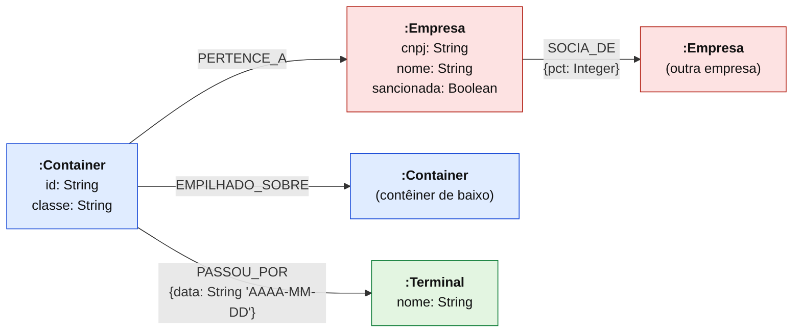
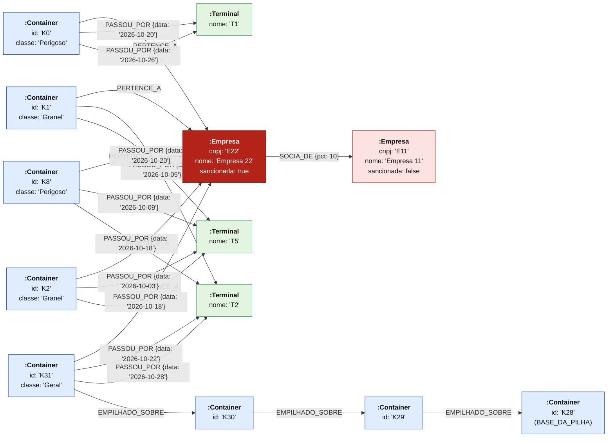

# C1 — Modelo do grafo do LogiPorto

Consultas usadas: [`c1_consultas.cypher`](c1_consultas.cypher) · saída real: [`c1_subgrafo_E22.txt`](c1_subgrafo_E22.txt)

## 1. Modelo (rótulos, relacionamentos, direções e propriedades)

`SOCIA_DE` e `EMPILHADO_SOBRE` ligam nós do **mesmo** rótulo. Desenhei duas caixas de `:Empresa` e duas de `:Container` só para a seta ficar legível. No banco é o mesmo rótulo.

| Relacionamento | Direção | Significado | Propriedade |
|---|---|---|---|
| `SOCIA_DE` | `(a:Empresa)-->(b:Empresa)` | **a** tem participação no capital de **b** | `pct`: % de participação |
| `PERTENCE_A` | `(:Container)-->(:Empresa)` | o contêiner é dessa empresa | — |
| `PASSOU_POR` | `(:Container)-->(:Terminal)` | o contêiner passou pelo terminal | `data`: dia da passagem |
| `EMPILHADO_SOBRE` | `(topo:Container)-->(base:Container)` | o de cima está apoiado no de baixo | — |

## 2. Exemplo real: EMPRESA_SANCIONADA (E22) e sócios diretos

Dados tirados do meu Neo4j (não inventados):
- E22 tem **um** sócio direto: ela é sócia da **E11** com **pct = 10**.
- **Nenhuma** empresa tem `SOCIA_DE` apontando para a E22.
- A E22 é dona de 5 contêineres. Mostro as passagens reais deles e a pilha da BASE_DA_PILHA (K28), porque o K31, que é da E22, está no topo dela.

## Legenda

| Elemento | Representa |
|---|---|
| Caixa vermelha escura | `:Empresa` com `sancionada: true` (E22) |
| Caixa vermelha clara | `:Empresa` |
| Caixa azul | `:Container` |
| Caixa verde | `:Terminal` |
| Seta `-->` | relacionamento, na direção em que está gravado no banco |
| `TIPO {prop: valor}` na seta | tipo do relacionamento e as propriedades **dele** |
| Texto dentro da caixa | rótulo e propriedades do nó |

## Por que não tem FK nem tabela associativa

- A participação societária não é uma tabela `socios(empresa_id, socia_id, pct)`. Ela é o próprio relacionamento `SOCIA_DE`, e o `pct` mora **na aresta**.
- A data da passagem também fica na aresta `PASSOU_POR`. Um contêiner que passou duas vezes no mesmo terminal tem **duas arestas** (como o K0 em T1 e o K31 em T2), e não duas linhas numa tabela de junção.
- O contêiner não guarda `dono_cnpj`. Quem diz o dono é a aresta `PERTENCE_A`. Para chegar da empresa ao terminal, o Neo4j segue ponteiros de nó em nó, sem precisar de JOIN por chave.
